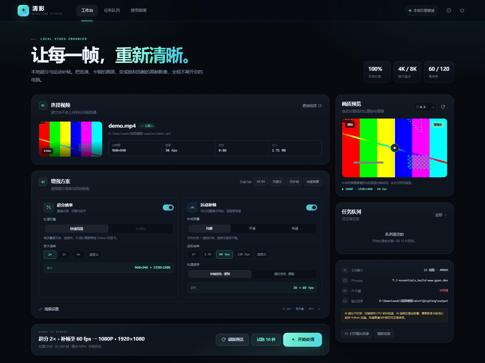
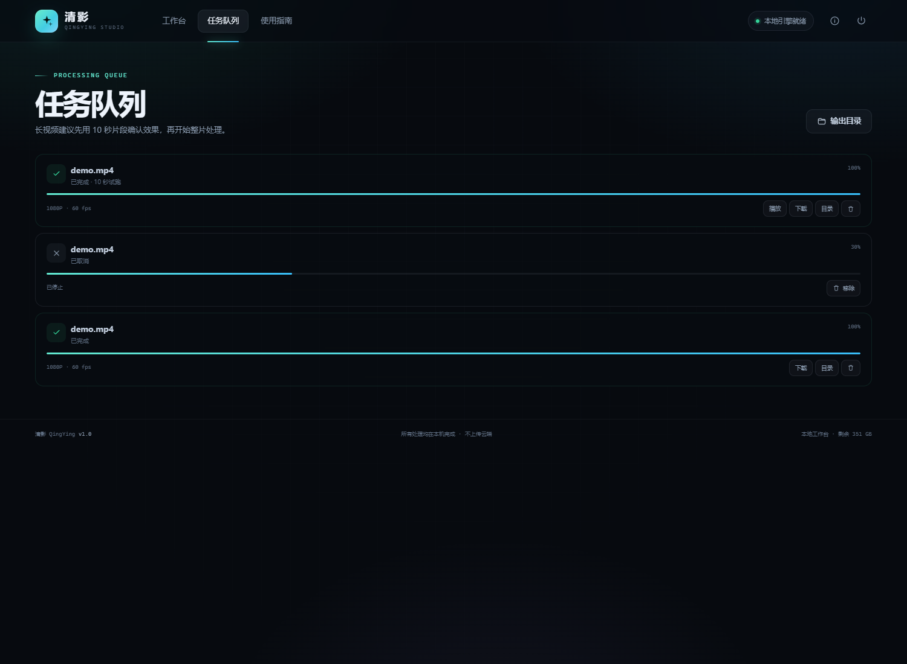

# 清影 QingYing

**本地视频超分与运动补帧工作台** · Windows 便携版 + 全平台本地 Web UI

[GitHub 仓库](https://github.com/Flyoverisblind/QingYing) · [下载便携版](https://github.com/Flyoverisblind/QingYing/releases/latest)

清影把视频放大、细节增强、光流补帧和视频编码放进一个现代化的本地界面。所有素材只在本机处理，不上传云端；几十 GB 的影片可以直接读取磁盘路径，无需复制或上传。





## 功能

- **超分辨率**
  - 快速高清：Lanczos 高质量重采样 + 自适应锐化 + 可选降噪，长视频可用。
  - AI 超分：Real-ESRGAN（x4plus / x4plus-anime / 轻量 x2），通过 Vulkan 显卡加速。
  - 支持 2× / 3× / 4× / 自定义高度，最高 8K 输出。
- **运动补帧**
  - 光流补帧：FFmpeg `minterpolate`，均衡 / 平滑 / 快速三档。
  - 目标 2× / 2.5× / 60fps / 120fps / 自定义。
  - **补帧优先**：先在原分辨率插帧再放大，比传统顺序快 3–5 倍。
- **画质预览**
  - 同一帧的原始 / 增强前后对比，可拖动分割线。
  - 10 秒试跑（会尊重当前处理区间），完成后直接在界面播放。
- **完整编码链路**
  - H.264 / H.265 / AV1；自动检测 NVENC / QSV / AMF / VideoToolbox 硬件编码。
  - 原始音频保留或转 AAC；MP4 / MKV；处理区间裁剪；自定义输出目录。
- **任务管理**
  - 队列、实时进度、速度、ETA、取消、失败原因、下载、打开输出目录、片段播放。
- **本地优先**
  - 文件浏览直接读取本机磁盘，大文件零拷贝。
  - 前后端都运行在 127.0.0.1，默认只允许本机访问。

## 直接使用

### Windows 便携版

1. 打开 `dist/QingYing/`。
2. 双击 `QingYing.exe`，浏览器会自动打开工作台。
3. 首次启动会在程序目录创建 `data/` 和 `output/`。
4. 关闭界面后应用仍在托盘运行；在托盘菜单中选「退出」，或在页面右上角点退出按钮。

便携版已内置 FFmpeg，无需额外安装。把整个 `QingYing` 文件夹拷到其他 Windows 电脑即可使用。

> 也可以从 [GitHub Releases](https://github.com/Flyoverisblind/QingYing/releases/latest) 下载打包好的 `QingYing-windows-amd64.zip`。

### 源码 / 全平台

要求 Python 3.10–3.12，Windows / macOS / Linux 均可。

```bash
git clone https://github.com/Flyoverisblind/QingYing.git
cd QingYing
```

然后：

```bash
# Windows
start.bat

# macOS / Linux
chmod +x start.sh
./start.sh
```

首次运行会自动创建 `.venv` 并安装依赖，然后打开浏览器。默认地址：<http://127.0.0.1:17876>。这个页面就是「网页版」工作台。

需要以纯 Web 方式挂到本机其他端口时：

```bash
./start.sh --no-tray --port 17876
# 或
.venv/bin/python launcher.py --no-tray --host 127.0.0.1 --port 17876
```

> 文件浏览接口会读取本机磁盘、任务接口会执行 FFmpeg。除非在可信局域网内，否则不要绑定 `0.0.0.0` 暴露到公网。

如果系统没有 FFmpeg，`requirements.txt` 中的 `imageio-ffmpeg` 会提供一份内置二进制；也可以手动安装完整版 FFmpeg：

```bash
# Windows (winget)
winget install Gyan.FFmpeg

# macOS
brew install ffmpeg

# Ubuntu / Debian
sudo apt install ffmpeg
```

## 打包 Windows exe

```bat
build_exe.bat
```

或手动：

```bash
python -m pip install -r requirements-dev.txt
python build_exe.py
```

产物：

- `dist/QingYing/QingYing.exe` — 便携目录版，启动快。
- `dist/QingYing-windows-amd64.zip` — 可直接分发的压缩包（GitHub Releases 也会提供）。

构建脚本会把 `vendor/ffmpeg.exe`（或 imageio-ffmpeg 的二进制）复制到 `dist/QingYing/bin/`。如需一起打包 `ffprobe`，把 `ffprobe.exe` 放进同一目录即可。

### macOS / Linux 打包

```bash
chmod +x build_app.sh
./build_app.sh
```

PyInstaller 会在当前平台生成 `dist/QingYing/`。托盘图标在 Linux 上需要 GTK/AppIndicator；没有桌面环境时用 `--no-tray` 启动。

## 使用建议

- **长视频先试跑**：在「高级设置」里填写开始/结束秒数，或直接点「试跑 10 秒」。确认画质和速度后再处理全片。
- **补帧优先**：同时开启超分和补帧时，默认「补帧优先」会先在原分辨率插帧，再放大。速度通常快 3–5 倍，适合长片；追求极限锐度可切换「超分优先」。
- **AI 超分需要 Vulkan**：NVIDIA / AMD / Intel 独显或较新的核显可能可用。检测不到硬件加速时界面会自动禁用 AI 模式，只保留快速高清；软件模拟的 AI 太慢，不作为可用选项。
- **编码器**：列表只显示当前 FFmpeg 真正可用的编码器。硬件编码失败会自动从列表中隐藏。H.264 兼容性最好，H.265 体积更小，AV1 需要 FFmpeg 带 SVT-AV1。
- **处理时间**：补帧是计算密集型操作。本机 i5-12400F（无独显）实测：960×540 → 1080p60、均衡补帧、1 秒片段约 3–6 秒；8 小时片源可能需要十几小时，建议分段。实际 ETA 以任务卡显示为准。
- **HDR**：当前版本统一输出 8-bit SDR。HDR10 / HLG 素材会被转换为 SDR，色彩可能与原播放器不同，界面会给出提示。

## 技术细节

| 模块 | 实现 |
| --- | --- |
| 本地服务 | FastAPI + Uvicorn，仅监听 127.0.0.1 |
| 前端 | 原生 HTML / CSS / JavaScript，无外部 CDN |
| 视频处理 | FFmpeg filter graph + 原始帧管道 |
| 超分（快速） | `scale=lanczos` + `unsharp` + 可选 `hqdn3d` |
| 超分（AI） | `realesrgan-ncnn-py`（Real-ESRGAN ncnn Vulkan） |
| 补帧 | `minterpolate`（MCI / blend，双向或双边光流） |
| 硬件编码 | NVENC / QSV / AMF / VideoToolbox 自动探测并试编码 |
| 打包 | PyInstaller onedir |

AI 模式的实现不是「导出帧到临时目录」，而是 FFmpeg 解码 → 原始 RGB 帧管道 → Real-ESRGAN 逐帧推理 → FFmpeg 滤镜/编码，避免海量临时文件。

## 目录结构

```
app/
  main.py          FastAPI 路由与静态资源
  ffmpeg.py        FFmpeg 探测、滤镜、编码器
  runner.py        单次滤镜任务 / AI 帧管道
  jobs.py          队列、状态、取消
  fs.py            文件浏览、缩略图、前后对比
  ai.py            Real-ESRGAN 探测与推理
  schemas.py       请求模型与目标分辨率
  static/          前端
launcher.py        桌面启动器、端口、托盘
QingYing.spec      PyInstaller 配置
build_exe.py       打包脚本
```

## API（本地）

| 方法 | 路径 | 说明 |
| --- | --- | --- |
| GET | `/api/system` | FFmpeg、AI、编码器、磁盘状态 |
| GET | `/api/fs?path=` | 浏览本机目录 |
| POST | `/api/probe` | 读取视频元数据 |
| POST | `/api/preview` | 生成前后对比帧 |
| POST | `/api/jobs` | 创建任务 |
| GET | `/api/jobs` | 任务列表与进度 |
| POST | `/api/jobs/{id}/cancel` | 取消任务 |
| GET | `/api/jobs/{id}/file` | 播放 / 下载输出（支持 Range） |

完整接口与字段见 `app/main.py`。

## 已知限制

- 补帧使用 FFmpeg 光流，不是 RIFE 等深度学习插帧；快速运动、字幕和遮挡处可能出现拖影。
- AI 超分依赖 Vulkan，仅 CPU 或软件 Vulkan 环境会被禁用。
- 输出暂不支持 HDR / 10-bit；HDR 素材会转为 SDR。
- 暂不支持批量多文件队列并行；任务按创建顺序串行处理。
- 8K 输出取决于显卡/内存和编码器能力，可能失败。

## 许可

MIT License。内置的 FFmpeg 二进制遵循其各自许可证（GPL/LGPL，取决于构建）；Real-ESRGAN 模型与 ncnn 运行时遵循上游项目许可。分发时请保留相应声明。
